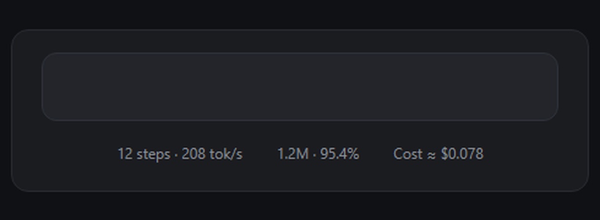

# dsh-client-ui-session-cost

A [DeepSeek Harness](https://github.com/deepseek-ai/deepseek-harness) client
plugin that adds a **session cost** estimate to the composer statistics dock —
the small row directly below the message input, next to the existing speed and
token pills.



```
Cost ≈ $0.15
```

Hover the pill for the token buckets, the rates in force, and the model used.
The number covers the whole Session (not just the loaded page of history)
because it prices DSH's durable `tokenUsage` projection, and it updates as the
Session streams.

## Install

### From the Discover tab

Turn on **Experimental plugins → Custom plugin markets**, open **Plugins →
Discover → Add index source**, and enter:

```
https://raw.githubusercontent.com/iskrantxusa/dsh-client-ui-session-cost/main/market/index.json
```

The market lists **Session cost pill**; install the version you want after the
usual confirmation. The index is plain format-1 JSON in
[`market/index.json`](market/index.json) and is pinned to a Git commit.

### From GitHub (recommended without the market)

```powershell
dsh plugin add github:iskrantxusa/dsh-client-ui-session-cost
```

Or in the Web GUI: **Sidebar → Plugins → Add plugin**, paste
`github:iskrantxusa/dsh-client-ui-session-cost`, and install.

The package is both a **bundle** and the **plugin** its patch inserts:
installation selects it in `dsh.profile.bundles`, applies its
`cordis.patch.yml`, and adds the `ui-session-cost` loader row. With HMR on
(the default) the pill appears without a restart; otherwise restart DSH.

### From the release tarball

Download
[`dsh-client-ui-session-cost-0.1.0.tgz`](https://github.com/iskrantxusa/dsh-client-ui-session-cost/releases/download/v0.1.0/dsh-client-ui-session-cost-0.1.0.tgz)
and use **Plugins → Add plugin** with the local file, or:

```powershell
dsh plugin add C:\path\to\dsh-client-ui-session-cost-0.1.0.tgz
```

### Manual (only when you cannot use the plugin manager)

Copy this directory to
`%USERPROFILE%\.dsh\profiles\desktop\node_modules\dsh-client-ui-session-cost`
and add to `%USERPROFILE%\.dsh\profiles\desktop\cordis.patch.yml`:

```yaml
- insert:
    - id: ui-session-cost
      name: dsh-client-ui-session-cost
```

Do **not** combine the manual row with a bundle install: both insert the same
row id. Remove the manual block before installing the bundle.

## Rates

DeepSeek list prices, USD per 1M tokens
([Models & Pricing](https://api-docs.deepseek.com/quick_start/pricing/)):

| Model | Cache hit (peak / off-peak) | Cache miss (peak / off-peak) | Output (peak / off-peak) |
|---|---|---|---|
| `deepseek-flash` | $0.006 / $0.003 | $0.30 / $0.15 | $1.20 / $0.60 |
| `deepseek-v4-pro` | $0.044 / $0.022 | $1.32 / $0.66 | $3.96 / $1.98 |

Peak is 01:00–04:00 and 06:00–10:00 UTC, Monday–Friday; all other hours,
weekends, and the Chinese holidays DSH does not know about are off-peak at
half price. The total is `cacheMiss + cacheRead + output`, where cache misses
include `cacheWriteTokens`.

The model is read from the `modelSelection` projection (`next`, else
`lastUsed`). An unknown model falls back to `deepseek-flash` rates and the
tooltip says "assumed rates". A Session that changed models mid-way is priced
entirely at its latest model; the projection keeps no per-request model
history. Search/Fetch API requests, tools with their own billing, and account
bonuses are not included.

To change rates, edit `PRICES` in [`lib/client.js`](lib/client.js), bump the
version, and reinstall.

## How it works

`lib/index.js` is an empty host half: it exists only so the Loader has a row
whose package declares `dsh.client`. The browser bundle
[`lib/client.js`](lib/client.js) registers one entry in the
`conversation.composer.dock` list slot (`id: cost`, `order: 2`) and prices the
Session-scoped `tokenUsage` projection, whose wire view is:

```js
{ uncachedInputTokens, outputTokens, cacheReadTokens, cacheWriteTokens }
```

No build step and no dependencies beyond React from the platform module table.
The bundle is a hand-written `window.__ModuleLoader__.load({...})` in the same
CJS-factory shape as the shipped client bundles.

## Requirements and caveats

- A Web or Desktop DSH profile. HMR is the default and applies the patch live;
  without HMR, restart DSH.
- The estimate is reference information, not a billing record. Prices can
  change; verify against DeepSeek's page.
- The plugin ships no telemetry and makes no network requests. It only reads
  the Session projection DSH already keeps.

## Uninstall

**Plugins → the bundle → Remove**, or the equivalent `dsh plugin` remove
command. For a manual install, delete the copied package and the
`- id: ui-session-cost` insert block.

## Development

```
lib/client.js       browser half: rates, tooltip, composer-dock entry
lib/index.js        host half: empty apply
cordis.patch.yml    bundle patch: inserts the ui-session-cost row
test/test-cost.cjs  dependency-free pricing/registration checks
```

```powershell
node test/test-cost.cjs
npm pack            # produces dsh-client-ui-session-cost-0.1.0.tgz
```

The test evaluates the bundle in a VM with a stub React and checks the
official-rate math, peak/off-peak boundaries, display rounding, unknown-model
fallback, and the exact `conversation.composer.dock` registration.

## License

MIT © 2026 IskrantX. See [LICENSE](LICENSE).
